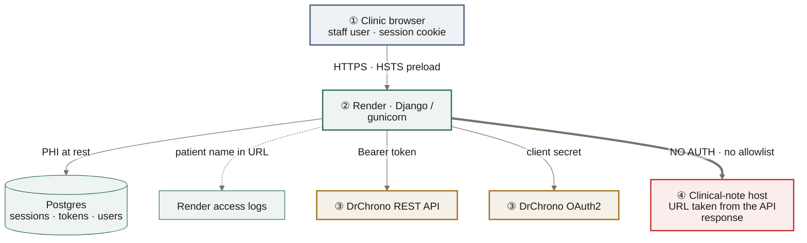
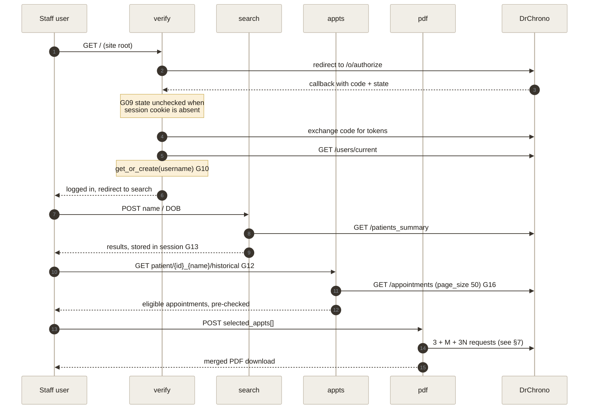
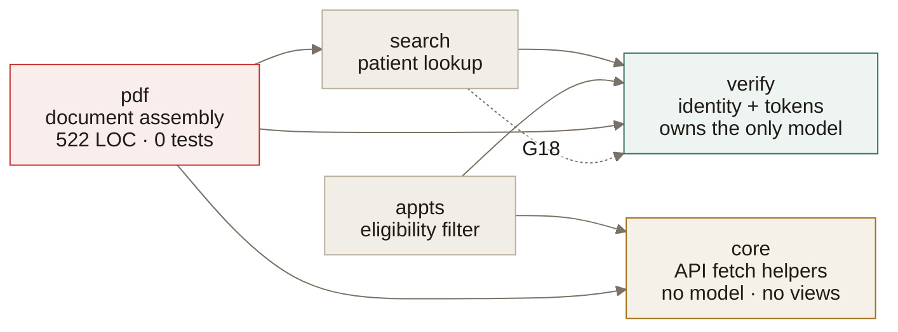
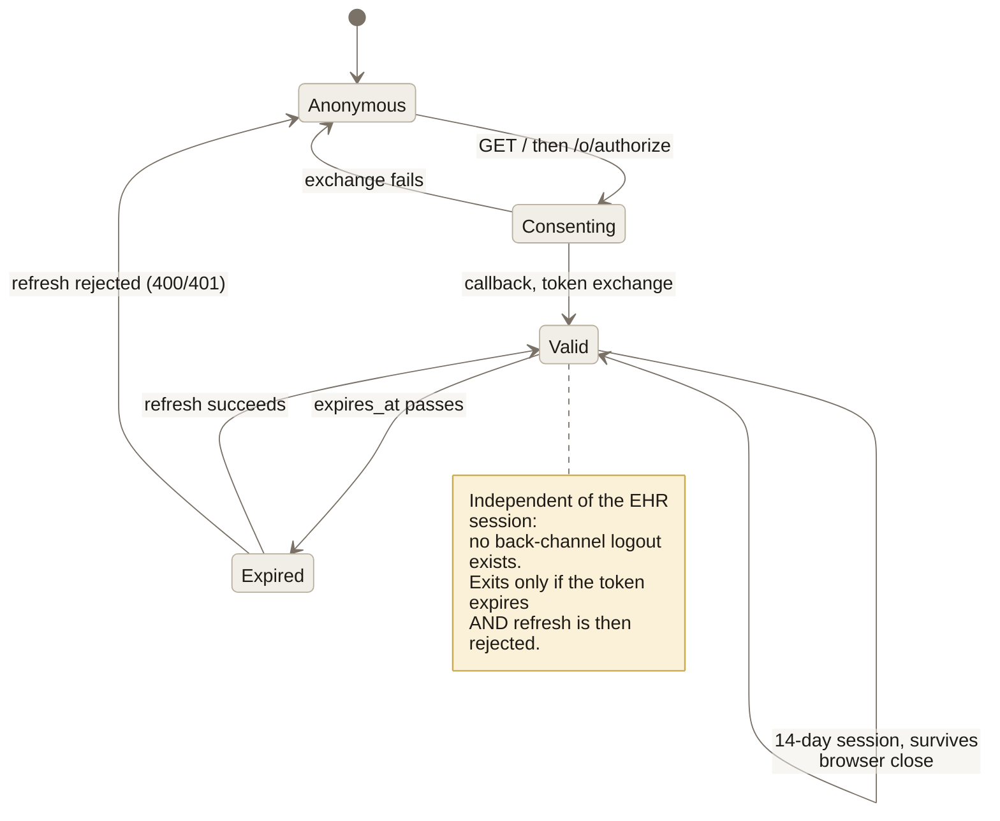
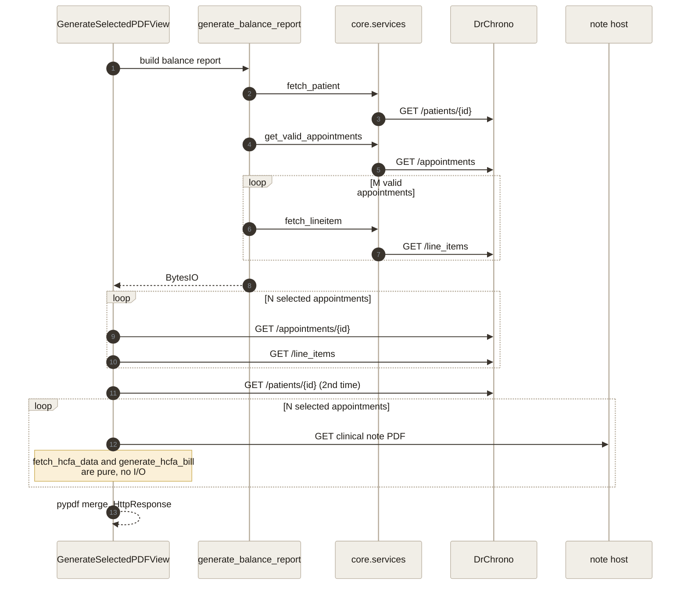
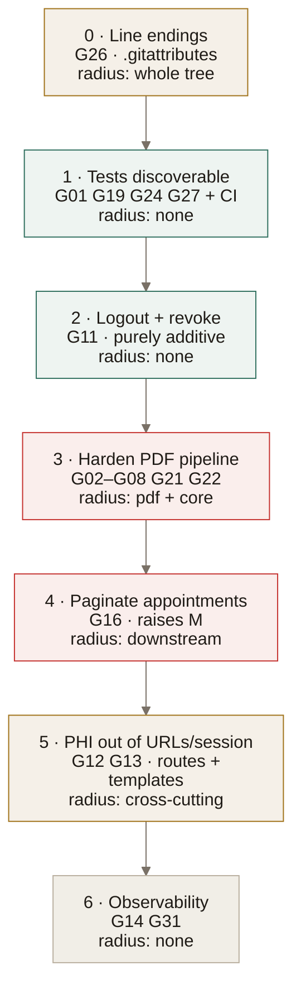

# Architecture

A top-down blueprint of the DrChrono PDF Compiler: how a request moves through the system, where patient data lives, what was decided on purpose, and what that cost.

**How this relates to the other docs.** [`README.md`](README.md) is the orientation and setup guide. The per-app `DOC.md` files are bottom-up — file by file, function by function. This document is the layer in between: cross-cutting concerns that don't belong to any single app. Where it disagrees with a `DOC.md`, this document reflects the code as of 2026-09-02 (see [§10](#10-where-the-docs-drift-from-the-code)).

**Status: as-built.** This describes what runs in production today, not a target design. Known defects are annotated inline as **⚠ G*nn*** and cross-reference the September 2026 code review's finding numbers. They are marked rather than silently corrected so that a reader comparing this to the source isn't misled about which behavior is intended.

---

## 1. Purpose & operating constraints

The app replaces a manual clerical process: staff previously pulled each clinical note and each billing form out of DrChrono by hand and stitched them into one packet per patient. It automates that assembly.

Five constraints shape every decision that follows:

- **Single tenant by design.** Provider identity — NPI, federal tax ID, practice address, signature block — is supplied through environment variables, not modeled. A second practice requires a second deployment.
- **DrChrono is the system of record.** The app stores no patient data of its own. Every patient fact is fetched live and discarded when the response ends.
- **The output is a legal billing artifact.** An HCFA-1500 goes to an insurer. Silently wrong output is worse than a visible failure — which is what makes ⚠ G16 the most serious defect in the system.
- **Real PHI, plus SSN/EIN and insurance detail.** Every design decision has a data-protection consequence, tracked in [§8](#8-data--phi-residency).
- **Small, known user population.** Clinic staff on practice machines. This is what makes a synchronous, queue-free architecture defensible ([§9.4](#9-design-decisions--trade-offs)).

---

## 2. System context & trust boundaries

Four processes, three of which are outside the app's control.

**Boundary 1 — browser to app.** The best-defended edge. HSTS with preload and subdomains, forced SSL redirect, secure session and CSRF cookies, `SECURE_PROXY_SSL_HEADER` set correctly for Render's TLS termination, CSRF origins pinned. `manage.py check --deploy` passes clean.

**Boundary 2 — app to Postgres.** Where PHI and credentials come to rest. See [§8](#8-data--phi-residency).

**Boundary 3 — app to DrChrono.** Bearer token per user, refreshed on expiry. Eight outbound call sites, all with explicit timeouts ([Appendix A](#appendix-a-outbound-call-inventory)).

**Boundary 4 — app to the clinical-note host.** The weakest link, and the only boundary crossed *without* credentials. `generate_clinical_notes` takes a URL out of an API response and issues `requests.get(pdf_url, timeout=15)` with no `Authorization` header, no host allowlist, and no scheme check. It works because DrChrono returns pre-signed URLs. It also means anything that can influence that field can make the server issue an arbitrary outbound GET and merge the bytes into a document handed to a user.

---

## 3. Runtime topology & config surface

| Concern | Choice | Note |
|---|---|---|
| Process model | Single gunicorn WSGI service on Render | `WEB_CONCURRENCY` is the only scaling dial |
| Static files | WhiteNoise, `CompressedManifestStaticFilesStorage` | No separate static host |
| Database | Postgres via `dj_database_url`, `conn_max_age=600` | Sessions, tokens, users only — no patient tables |
| Async work | **None** | No queue, worker, or job store — see [§9.4](#9-design-decisions--trade-offs) |
| Caching | **None** | Every page view re-fetches from DrChrono |
| Observability | **None** ⚠ G31 | `LOGGING` unset, `ADMINS` empty — unhandled 500s go nowhere |
| Build | `build.sh`: install → collectstatic → migrate | |
| Start command | `gunicorn drchrono_compiler.wsgi:application` | ⚠ G30 — lives only in the Render dashboard, not in the repo |

**Config surface.** 18 environment variables across four groups: Django core (3), DrChrono OAuth (4), Render (1), and provider identity (10). There is deliberately no `.env` loader — the README documents this. Provider identity is read with `os.getenv` at call time inside `pdf/services.py` rather than through `django.conf.settings`, so those 10 values bypass Django's config layer entirely and are unvalidated at boot: a missing `PROVIDER_NPI` surfaces as a blank box on a claim form, not a startup error.

---

## 4. The user journey

Four steps, each a full page load. There is no client-side state and no JavaScript beyond dismissing an alert.

Three properties worth naming:

- **The OAuth entry point is the homepage.** `verify` is mounted at `''`, so an unauthenticated visitor is redirected straight into DrChrono's consent screen. There is no landing page.
- **The journey is one-directional and stateful.** The results page reads from the session, not the URL, so it can't be bookmarked, linked, or safely opened in two tabs.
- **Exit is delegated to DrChrono, but only entry actually is.** There is no logout view; DrChrono is the sole identity provider, so one was never needed to gate *entry*. Exit, however, does not propagate: `login()` mints a Django session independent of the EHR's, and a protected page serves with **zero outbound calls** while the access token is valid (verified). Signing out of the EHR therefore leaves the app session live for up to 14 days ⚠ G11. See [§6](#6-identity--token-lifecycle).

---

## 5. Module map & coupling

**`verify` is the hub.** Every protected view routes through `require_auth`, and `DrChronoCredential` is the only model in the project. A change to token handling has system-wide blast radius; nothing else does.

**`core` is a leaf.** Three stateless fetch helpers plus the appointment eligibility filter. It takes `requests` as a parameter rather than importing it — dependency injection that no caller ever exercises with anything but the real module, though it does make the helpers trivially mockable.

**`pdf` is the risk concentration.** 522 lines, zero test coverage, the only module doing real computation, and the only one whose output leaves the building as a legal document. Eight of the review's blockers live here or in the `core` helpers it calls.

**One boundary violation.** `appts` and `pdf` both re-derive the same appointment list independently rather than passing it forward, which is the root of the fan-out in [§7](#7-the-pdf-pipeline).

---

## 6. Identity & token lifecycle

DrChrono is the sole identity provider. Django users are created passwordless (`set_unusable_password()`); the app never authenticates a credential of its own.

### What actually ends a session

The intent behind having no logout button is sound — DrChrono is the only way in, and the app stores no password of its own. The part that doesn't hold is the assumption that signing out of the EHR signs the user out here. Three facts from the code:

1. **The Django session is independent.** `login(request, user)` in `verify/views.py:73` mints the app's own session cookie. DrChrono has no back-channel logout, no front-channel logout, and no session-check call anywhere in this codebase — there is no mechanism by which it could tell the app.
2. **A valid access token means no network at all.** With `requests.get`, `requests.post` and `Session.request` all patched to raise, the patient-search page still returns **200**. The app cannot observe EHR logout because on that path it never speaks to DrChrono.
3. **The refresh token is designed to outlive the user's session.** When the access token does expire, `refresh_token()` mints a new one non-interactively. Refresh tokens survive an interactive logout by design; they end on explicit revocation or expiry.

So the session ends only when the access token expires **and** DrChrono rejects the refresh — not when the user signs out of the EHR. Cookie lifetime is 14 days with `SESSION_EXPIRE_AT_BROWSER_CLOSE = False`.

The practical consequence is narrow but real: on a shared front-desk machine, signing out of the EHR does not clear this app, and nothing in the UI can. Whether that's worth a logout view is a judgement call about the deployment, not a defect in the OAuth design.

**The identity model has a namespace collision.** `User.objects.get_or_create(username=<drchrono username>)` treats DrChrono's username as a Django primary identity. Any pre-existing Django user with a matching name — a superuser created via `createsuperuser`, most obviously — is adopted rather than created, handing whoever holds that DrChrono account a logged-in session for it. `/admin/` is routed and reachable ⚠ G10.

**Refresh logic itself is correct.** Expiry tracking, rotation, the fallback when DrChrono omits a new refresh token, and the 400/401 re-auth branch are all right. The defect is at the edges, not the core.

---

## 7. The PDF pipeline

The system's real work, and the place its architecture is most visible.

### Cost model

For a patient with **M** eligible appointments and **N** selected:

> **Requests per PDF = 3 + M + 3N**, issued sequentially, inside one HTTP request/response cycle.

A patient with 40 eligible appointments, all selected, costs **163 sequential HTTP requests** before a single byte reaches the browser — plus one more the `appts` page already spent fetching the same list. There is no queue, no retry, no partial progress, and no timeout budget: the only bound is Render's request limit.

Three of those terms are avoidable. `fetch_patient` runs twice. `get_valid_appointments` re-fetches a list `appts` already had. The per-appointment line items are fetched once for the balance report and again for the HCFA forms.

### Composition

The output is a single `PdfWriter` merge: one balance report, then per selected appointment a clinical note followed by its HCFA-1500. The HCFA form is a **pixel-positioned overlay**, not AcroForm field filling — roughly 60 hand-derived `drawString` coordinates rendered onto a ReportLab canvas and merged onto a static template. It gives exact print registration on a flattened template at the cost of being locked to that one file.

**Failure is all-or-nothing** ⚠ G02–G08. Every unhandled exception anywhere in the chain unwinds to one `except Exception` that discards the entire packet and redirects. The documented "skip a missing note and continue" path returns an empty buffer that pypdf refuses to read, so the degradation branch is itself a failure branch ⚠ G03.

---

## 8. Data & PHI residency

The central question for a compliance reader: **what patient data comes to rest, and for how long?**

| Data | Where it lives | Lifetime | Assessment |
|---|---|---|---|
| Clinical note PDFs | Memory (`BytesIO`) only | Request | ✅ Never touches disk |
| Patient demographics, ICD-10, charges | Memory only | Request | ✅ Never persisted |
| Generated composite PDF | Streamed to the response | Request | ✅ Never written to disk |
| Provider identity (NPI, tax ID) | Render env vars | — | ✅ Never in source control |
| **Search results** (name, DOB, chart ID) | `django_session`, Postgres | **14 days** | ⚠ G13 — no `clearsessions`, so expired rows are never deleted |
| **Patient name** | URL path **and** query string | Indefinite | ⚠ G12 — Render access logs, browser history, `Referer` headers |
| **OAuth access + refresh tokens** | `DrChronoCredential`, plaintext | **Forever** | ⚠ G15 / G11 — unencrypted; no logout means no deletion path |
| DrChrono username | `auth_user` | Forever | ⚠ G10 — doubles as a login identity |
| Exception text (may embed URLs/payloads) | Messages framework → session → screen | Until displayed | ⚠ G14 |
| Unhandled 500 tracebacks | **Nowhere** | — | ⚠ G31 — no logging configured |

**The core design is sound.** The decision not to mirror patient data locally means the most sensitive content — clinical notes, demographics, the assembled claim — exists only in memory for the life of one request. That is the right architecture for this problem and it eliminates an entire class of breach.

**The leaks are all at the edges.** Every item in the lower half of that table is incidental: a convenience cache in the session, a display name routed through a URL, a credential with no deletion path. None is load-bearing, which means each can be fixed without touching the architecture.

---

## 9. Design decisions & trade-offs

What was chosen deliberately, and what each choice cost.

**9.1 — DrChrono as the sole identity provider.** No passwords stored, no reset flow, no separate account provisioning; staff use credentials they already have. *Cost:* the identity namespace collides with Django's ⚠ G10, and access can't be granted to anyone without a DrChrono seat.

**9.1b — Exit delegated to the identity provider.** No logout view, on the reasoning that DrChrono gates access. Correct for entry, and it keeps the app free of any password or session-management surface of its own. *Cost:* the delegation is one-way — the app's session outlives the EHR's by up to 14 days with no way to end it from this side ⚠ G11.

**9.2 — Read-through with no local patient mirror.** No PHI database to secure, sync, or migrate; DrChrono stays authoritative. *Cost:* every page view is API round-trips, nothing is cacheable, and the app is unusable whenever DrChrono is down.

**9.3 — Session as the search→results hand-off.** Simpler than threading filters through query params, and keeps patient identifiers out of the results URL. *Cost:* PHI at rest for 14 days ⚠ G13, and a results page that can't be linked, refreshed independently, or safely opened twice.

**9.4 — Synchronous PDF generation.** No queue, no worker, no job store, no polling UI, no partial-state reconciliation — a large amount of infrastructure avoided, and reasonable for a handful of staff generating a few packets a day. *Cost:* the 3 + M + 3N fan-out runs against a hard request timeout with no retry and no progress indication. This is the decision most likely to need revisiting, and the one it would be most honest to describe in an interview as *correct for the constraints, with a known ceiling*.

**9.5 — Pixel-positioned HCFA overlay.** Exact print registration on a flattened template, which AcroForm filling can't guarantee. *Cost:* ~60 hand-derived coordinates locked to one template file; a revised form means re-deriving all of them, and nothing validates that text fits its box.

**9.6 — `core` helpers that accept `requests` as a parameter.** Stateless and trivially mockable. *Cost:* injection no caller varies — the seam exists but is never used.

**9.7 — WhiteNoise over a CDN.** One service to operate. *Cost:* none at this scale, though it does mean `pdf/static/HCFA.pdf` is published as a public URL by `collectstatic` ⚠ G21.

---

## 10. Where the docs drift from the code

The per-app `DOC.md` files describe intent accurately but have drifted in four places. Each drift describes behavior that is *safer than reality*, which is the dangerous direction.

| Doc | Claim | Reality |
|---|---|---|
| `search/DOC.md` | `search_patients` raises `ValueError` on API or network failure | Raises `RuntimeError`; network errors aren't caught at all ⚠ G19 |
| `pdf/DOC.md` | An empty buffer is returned "rather than breaking the whole merge" | The empty buffer *is* what breaks the merge ⚠ G03 |
| `core/DOC.md` | The three helpers set no timeout and don't call `raise_for_status()` | All three do both |
| `drchrono_compiler/DOC.md` | Describes `asgi.py` as an unused leftover | No `asgi.py` exists |

---

## 11. Change sequencing & blast radius

For planning the remediation work. Ordered by dependency, not severity.

Four sequencing constraints that aren't obvious from severity alone:

1. **Line endings first.** Every subsequent change otherwise lands inside a 582-line whitespace diff and becomes unreviewable.
2. **Tests before touching `pdf`.** `pdf/services.py` is 522 lines with zero coverage. Hardening it without a suite is unverifiable.
3. **Harden before paginating.** Fixing ⚠ G16 raises *M*, which pulls in more appointments and makes every crasher in ⚠ G02–G08 *more* likely to fire. Paginating first would convert a silent-truncation bug into a visible-crash bug.
4. **⚠ G02 and ⚠ G12 are the same code.** The broken redirect target and the patient-name-in-URL problem both live in the `appts` route shape and the `pdf` redirect that reverses it. Fix them in one change or you'll touch the same four call sites twice.

---

## Appendix A: Outbound call inventory

Every point the app makes a network request.

| # | Call site | Endpoint | Auth | Timeout |
|---|---|---|---|---|
| 1 | `verify/views.py:47` | `GET /api/users/current` | Bearer | 10s |
| 2 | `verify/services.py:24` | `POST /o/token/` | client secret | 10s |
| 3 | `search/services.py:41` | `GET /api/patients_summary` | Bearer | 10s |
| 4 | `core/services.py:33` | `GET /api/appointments` | Bearer | 10s |
| 5 | `core/services.py:3` | `GET /api/appointments/{id}` | Bearer | 10s |
| 6 | `core/services.py:9` | `GET /api/line_items` | Bearer | 10s |
| 7 | `core/services.py:15` | `GET /api/patients/{id}` | Bearer | 10s |
| 8 | `pdf/services.py:176` | clinical note PDF (URL from API) | **none** ⚠ | 15s |
| — | — | `POST /o/revoke_token/` | — | **never called** ⚠ G11 |

Also reachable but unused by the application flow: `/admin/`, routed in `drchrono_compiler/urls.py:6`.

---

*Blueprint reflects the codebase as of 2026-09-02. Gap references ⚠ G01–G31 map to the September 2026 code review.*
