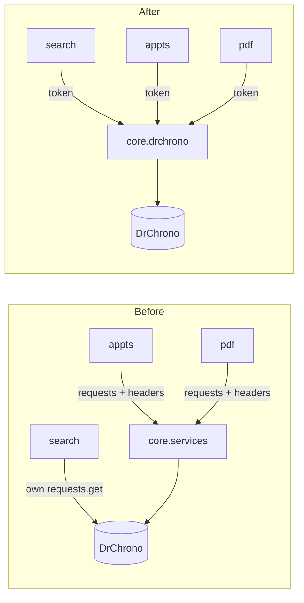
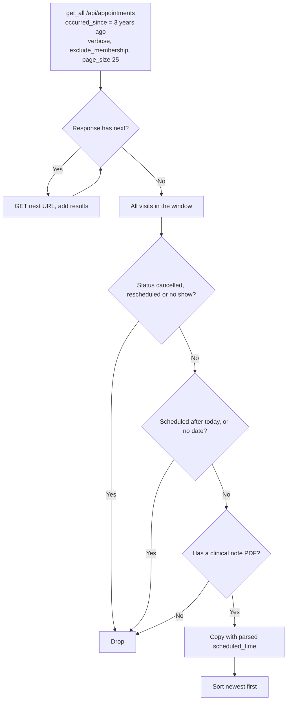

# Core Overhaul Plan

Rewrite of the `core` app (every DrChrono data call except sign-in) as one small DrChrono client module. Scope is `core`, plus mechanical call-site updates in `search`, `appts` and `pdf`: they pass a token instead of the `requests` module and headers. Their logic is overhauled later.

## Decision

**Direction A: a small client module of plain functions** (`core/drchrono.py`), in the same style as `verify/services.py`.

- One place builds the URL, auth header and timeout, turns failures into one error type, and follows DrChrono's page links.
- Fixes the missing-visits paging bug, the wrong date filter and known bug #3 in one place.
- Tests fake DrChrono in one place instead of four.

Rejected: a client class (B, more structure for little gain once calls are reduced), fixing in place (C, keeps the `requests`/headers plumbing and `search`'s duplicate HTTP code).

## DrChrono facts this relies on

From the [API docs](https://drkurokawa.drchrono.com/api-docs/):

- Base URL `https://app.drchrono.com`; auth header `Authorization: Bearer <token>`.
- List endpoints return `{"previous", "results", "next"}`; `next` is the full URL of the next page or `null`.
- `/api/appointments`:
  - max 20 per page, or 25 with `verbose=true` (the docs give both numbers)
  - results come back in scheduled-date order
  - one of `since`, `occurred_since`, `date` or `date_range` is required
  - **`since` filters by updated/created date; `occurred_since` filters by scheduled time**
  - `verbose=true` adds `clinical_note`
  - `exclude_membership=true` drops membership-charge placeholder appointments
- `/api/line_items` filters by `appointment` **or `patient`** (default page size 250).
- Rate limit: 500 calls per hour per app; over it, DrChrono returns `429`.

## Problems being fixed

| Problem | Where |
|---|---|
| Only the first page of appointments is read; DrChrono caps it at 20–25, so patients with more visits lose the overflow (the newest, if results are oldest-first) | `get_valid_appointments` |
| The 3-year window uses `since` (last updated/created) instead of `occurred_since` (scheduled time) | `get_valid_appointments` |
| Membership placeholder appointments aren't excluded | `get_valid_appointments` |
| Known bug #3: a visit with only `date` passes the filter, then crashes on `appt['scheduled_time']` | `get_valid_appointments` |
| Response dicts are changed in place (`scheduled_time` overwritten with a `datetime`) | `get_valid_appointments` |
| Every caller passes the `requests` module and builds its own auth headers; four copies of the DrChrono URL (`core`, `search`, plus `verify`'s own) | `core`, `search`, `appts`, `pdf` |
| Callers ignore `request.drchrono_token` and fetch the token again via `get_valid_access_token` | `search`, `appts`, `pdf` |
| No common error type: callers catch `requests.HTTPError` or bare `Exception` | `core`, `search` |
| Empty `startapp` stubs (`models.py`, `views.py`, `admin.py`, `migrations/`) | `core/` |

## Target design

### Files

| File | Contents |
|---|---|
| `core/drchrono.py` | New: `DrChronoError`, `get`, `get_all`, `patient`, `appointment`, `line_items`, `eligible_appointments` |
| `core/services.py` | Deleted (replaced by `drchrono.py`) |
| `core/models.py`, `views.py`, `admin.py`, `migrations/` | Deleted (empty stubs) |
| `core/testing.py` | `FakeDrChrono` reworked to patch one place and serve paged results |
| `core/tests.py` | Rewritten for `drchrono.py` |

### `core/drchrono.py`

```python
DRCHRONO = 'https://app.drchrono.com'

class DrChronoError(Exception):           # .status = HTTP status code, or None for network/JSON errors
def get(token, path_or_url, **params) -> dict          # one request: base URL, Bearer header, timeout=10
def get_all(token, path, **params) -> list[dict]       # follows `next` until null, returns all `results`
def patient(token, patient_id) -> dict                 # /api/patients/{id}
def appointment(token, appt_id) -> dict                # /api/appointments/{id}?verbose=true
def line_items(token, **filters) -> list[dict]         # /api/line_items, by appointment= or patient=
def eligible_appointments(token, patient_id) -> list[dict]
```

`eligible_appointments(token, patient_id)` is still the single definition of an "eligible" visit:
1. `get_all('/api/appointments', patient=…, occurred_since=<3 years ago>, verbose='true', exclude_membership='true', page_size=25)`
2. Keep visits that are not `Rescheduled`, `Cancelled` or `No Show`, are scheduled today or earlier (from `scheduled_time`, falling back to `date`), and have a clinical note PDF URL.
3. Return new dicts with `scheduled_time` parsed to a `datetime` (the list template formats it); the API data itself is never modified.
4. Newest first.

### Diagrams

Who calls DrChrono, before and after:



`eligible_appointments`, with paging:



### Call sites (mechanical only)

| File | Change |
|---|---|
| `appts/views.py` | `eligible_appointments(self.request.drchrono_token, patient_id)`; drop the `requests` import and the token re-fetch |
| `pdf/services.py` | `generate_balance_report` uses `drchrono.patient`, `eligible_appointments`, `line_items(appointment=…)` with the token it already receives. The clinical-note download stays as is (`pdf` overhaul). |
| `pdf/views.py` | `drchrono.appointment`, `line_items`, `patient` with `request.drchrono_token` |
| `search/services.py` | `drchrono.get(token, '/api/patients_summary', …)`; keeps its 401/403 → `DrChronoAuthError` and other-status messages, using `DrChronoError.status` |
| `verify/services.py` | Delete `get_valid_access_token` once nothing calls it |

API call counts stay the same apart from extra pages for patients with many visits. That's the paging fix working. The big reduction is optional extra 1.

### Removed

- `core/services.py` and its `requests`/headers calling convention.
- `search`'s own `DRCHRONO_BASE` and HTTP code.
- `verify.services.get_valid_access_token` (compatibility shim, no callers left).
- Empty stubs in `core/`.

## Implementation steps

Each step ends with `pytest` passing for what it touches, then its **simplicity check**. If a check fails, simplify before moving on.

Applies to every step:
- No class where a function will do (`DrChronoError` is the one class).
- No wrapper that only renames another function.
- No settings, constants or parameters for values that never change or are used once.
- No `try`/`except` broader than needed; no re-raise-only handlers.
- No dead code, commented-out code, `print` debugging or `PRINT_ERRORS` flags.
- Comments explain *why*; docstrings are one line.

1. **Client module**: write `core/drchrono.py`, rework `FakeDrChrono` in `core/testing.py` to patch `requests.get` once and serve `next` pages, rewrite `core/tests.py`. Tests: URL/header/timeout, error → `DrChronoError` with status, paging across 3 pages, each filter, date fallback (known bug #3 must pass), input dicts unchanged, newest first, request params (`occurred_since`, `exclude_membership`, `verbose`, `page_size`).

   *Simplicity check:*
   - `drchrono.py` ≤ 90 lines including blank lines.
   - Exactly one `requests.get` call site and one place that builds the auth header.
   - `get_all` is a single loop; no page counters or recursion.
   - `eligible_appointments` reads top to bottom with at most two levels of nesting; the clinical-note check is one expression.
   - `FakeDrChrono` stays a small class (routes + `get`); no per-test subclassing.

2. **Call sites**: switch `appts`, `pdf`, `search` to `core.drchrono` and `request.drchrono_token`; delete `core/services.py`. Update those apps' tests to the reworked `FakeDrChrono`.

   *Simplicity check:*
   - Every call-site diff is a swap of arguments/imports; no logic changes beyond `search`'s status mapping reading `DrChronoError.status`.
   - `grep -rn "requests" search appts pdf` shows only `pdf`'s clinical-note download.
   - `grep -rn "app.drchrono.com"` in app code shows only `core/drchrono.py` and `verify/services.py`.
   - No caller builds an `Authorization` header.

3. **Cleanup**: delete `get_valid_access_token` and the empty `core` stubs; confirm `manage.py check` and `makemigrations --check` pass.

   *Simplicity check:*
   - `grep -rn "get_valid_access_token\|core.services\|fetch_lineitem\|fetch_appointment\|fetch_patient\|get_valid_appointments" .` (code and tests) returns nothing.
   - `core/` contains only `__init__.py`, `apps.py`, `drchrono.py`, `testing.py`, `tests.py`, `DOC.md`.

4. **Docs**: rewrite `core/DOC.md` (detail matching the module, no line limit); update `CLAUDE.md` (DrChrono access and tests sections), `SYSTEM_MAP.md` (components diagram), `README.md` (endpoint table), `verify/DOC.md` (shim removed).

   *Simplicity check:*
   - No doc mentions `core.services`, passing `requests`/headers, `since` for the 3-year window, or "first page of 50".

5. **Manual check (local)**: open a patient with many visits and confirm the list matches DrChrono (count and newest visit); generate a PDF; search still works including the "no matches" message.

   *Simplicity check:*
   - Read `drchrono.py` top to bottom once more; anything that needs a second read gets simplified.

6. **Merge**: run `/simplify` on the full diff, apply what it finds, PR to `main`. No Render changes.

## Done when

- Known bug #3 test passes; the other 3 known bugs (in `pdf`) unchanged.
- All other tests pass; `search`, `appts`, `pdf` behave the same apart from the paging and date-window fixes.
- Every step's simplicity check holds.
- Local manual check passes.

## Optional extras (not in scope until chosen)

1. **Fewer API calls for PDFs**: balance report and PDF view use `line_items(patient=…)` once (grouped by appointment) and reuse the already-fetched eligible appointments instead of re-fetching each selected one. About 33 → 4 calls for a patient with 20 visits, 5 selected. One-line change in the balance report alone captures most of it.
2. **Rate-limit message**: map `DrChronoError.status == 429` to "DrChrono's hourly limit was reached, try again after the top of the hour."
3. **Shared base URL**: `verify/services.py` imports `DRCHRONO` from `core.drchrono` instead of its own copy.
4. **Connection reuse**: one `requests.Session` per request (only worth it if PDFs feel slow after extra 1).
