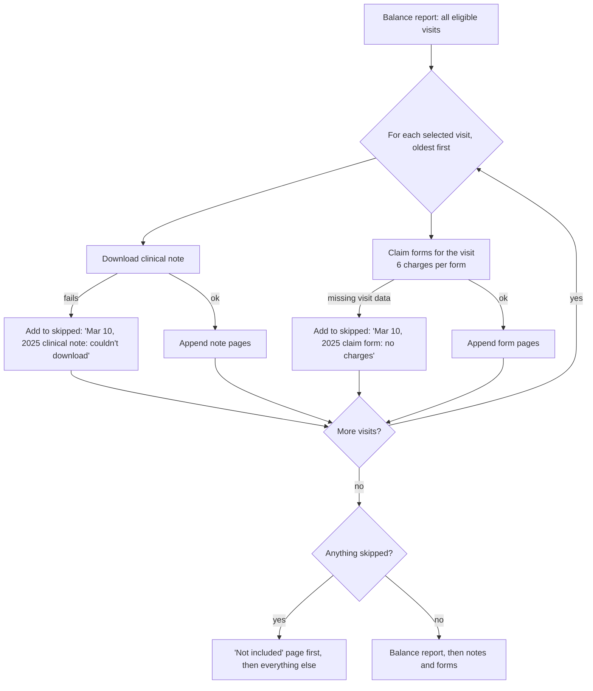

# PDF Overhaul Plan

Rewrite of the `pdf` app, which builds the billing PDF: the balance report, then each selected visit's clinical note and HCFA-1500 claim form. Scope is `pdf` only. It uses `core.drchrono` and `require_auth` as they are.

## Decisions

- **Direction A: a lean split into four modules.**
  - `views.py`: thin
  - `packet.py`: fetch everything once and assemble the PDF
  - `balance.py`: the balance report
  - `hcfa.py`: the claim form fields, the coordinate map as data, and drawing

  Rejected: the full `REDESIGN.md` §3 structure (B, about 9 modules of mostly handover code) and fixing in place (C, keeps the 250-line drawing function).
- **When one visit's part fails, skip it and list it.** The PDF still downloads, with a first page titled **"Not included"** listing each skipped piece and why. Problems that block *every* claim (missing patient or practice details) still stop the PDF with a plain message.
- **More than 6 charges on a visit:** print **extra claim forms** for that visit, 6 charges per form, each with its own total.

## DrChrono facts this relies on

- `core.drchrono.eligible_appointments(token, patient_id)` returns every eligible visit (verbose: includes `clinical_note` with `pdf` and `updated_at`, `reason`, `scheduled_time`).
- `GET /api/appointments/{id}` documents `icd10_codes`. The list returns the same appointment objects (production already reads `clinical_note`, `reason` and `status` from it), so the list's `icd10_codes` are used. **Step 6 verifies this on real data.** If a listed visit has no `icd10_codes` key, `packet.load` fetches that one visit (`drchrono.appointment`) as a fallback.
- `GET /api/line_items?patient=` returns all of a patient's line items. Each has an `appointment` field, so they can be grouped by visit.
- Clinical note PDFs are downloaded from the `clinical_note.pdf` URL with no auth header (as today).
- Rate limit: 500 calls per hour.

## Problems being fixed

| Problem | Where |
|---|---|
| One failing piece aborts the whole PDF with raw text ("PDF generation failed." + `['Missing Patient Zip']` or `DrChrono request failed: 404 …`); **known bug**: failed note download | `views.py`, `generate_clinical_notes` |
| **Known bug**: a phone number that isn't 10 digits crashes the claim form (`IndexError`) | `fetch_hcfa_data`, `generate_hcfa_bill` |
| A visit with more than 6 charges prints rows 7+ over boxes 25–33 | `generate_hcfa_bill` |
| Posted visit IDs aren't checked against the patient's eligible visits, so another patient's visit could end up on this claim; order relies on the template's newest-first list being reversed | `views.py` |
| A 401 during generation is caught by `except Exception` and shown as raw text instead of going to sign-in | `views.py` |
| Same data fetched up to 3 times: about 33 DrChrono calls for 20 visits / 5 selected | `views.py`, `generate_balance_report` |
| About 250 lines of `drawString` with `PRINT_ERRORS` flags; mutates its input; coordinates spread through code | `generate_hcfa_bill` |
| `HCFA.pdf` opened by relative path (breaks outside `drchrono_compiler/`) and published by `collectstatic` from `static/` | `generate_hcfa_bill`, `pdf/static/` |
| Overlay merges onto a page not attached to a writer: breaks in pypdf 7 | `generate_hcfa_bill` |
| Balance report: zero balance found by string `'0.00'`; mutates the shared ReportLab stylesheet; invalid `ALIGN` entry | `generate_balance_report` |
| Class view with empty `dispatch`, unused `login_url`, mid-file duplicate imports, stale comments, f-strings without placeholders | `views.py`, `services.py` |

## Target design

### Files

| File | Contents |
|---|---|
| `views.py` | `generate(request, patient_id)`: POST only, `@require_auth`. Parses ticked IDs, calls `packet.load` and `packet.build`, returns the PDF download (`Patient_<First>_<Last>_REPORT.pdf`), or redirects to the visit list with a plain message. |
| `packet.py` | `load(token, patient_id, selected_ids)`, `build(packet)`, `download_note(url)` and the "Not included" page. |
| `balance.py` | `balance_report(patient, appointments, line_items) -> bytes`. Pure: no fetching. |
| `hcfa.py` | `missing_details(patient)` (patient + practice fields every claim needs), `claim_forms(patient, appointment, line_items) -> list[bytes]`, `LAYOUT` (the coordinate map as data, numbers moved unchanged), and drawing as a loop over `LAYOUT`. |
| `forms/HCFA.pdf` | The blank template, moved out of `static/`, opened by a path built from `Path(__file__)`. |
| `services.py`, `static/` | Deleted. |

### `packet.load(token, patient_id, selected_ids)`

1. Fetch once:
   - `drchrono.patient`
   - `eligible_appointments` (every page)
   - `line_items(patient=…)` (every page), grouped by `appointment`
2. **Check the selection:** every ticked ID must be one of this patient's eligible visits. If one isn't, raise `PacketError("The visit list changed. Reload the page and try again.")`.
3. **Check details every claim needs** with `hcfa.missing_details(patient)`: name, date of birth, address, city, state, zip, and the `PROVIDER_*` settings. If any are missing, raise `PacketError` listing them in plain words ("Can't build claim forms: missing patient zip code, city.").
4. Return a dict: `patient`, `appointments` (all eligible, for the balance report), `selected` (oldest first, by `scheduled_time`), `line_items` (by visit ID).

**About 3 DrChrono calls** (plus one per extra page), against about 33 today. Clinical-note downloads are extra, one per selected visit.

### `packet.build(packet) -> bytes`

Visit-level failures are caught per piece, by type, never `except Exception`:
- `NoteError`: download failed, wasn't a PDF, or no URL
- `ClaimError`: no line items, no ICD-10 codes, no signature date

`DrChronoAuthError` is never caught, so it reaches `require_auth` and the user goes to sign in.

### `hcfa.py`

- **`LAYOUT`:** `{field: (x, y)}` and row offsets for the 6 service lines, copied verbatim from today's `drawString` calls (y measured from the top, as now). Checkboxes are entries too.
- **`claim_forms(...)`:** builds one field dict per group of 6 charges, then draws each group on a canvas, overlaid on the template via `PdfWriter(clone_from=HCFA_TEMPLATE)` (the pypdf 7-safe way). Box 28's total is per form.
- **Phone:** 10 digits → `area` / `number` as today. Anything else → the digits as-is in the number box, with the area code blank (fixes the known bug).
- **Hardcoded values stay as they are** (insured = self, place of service 11, diagnosis pointer `a`, 1 unit, EIN, accept assignment, auto accident yes, "Signature on File"), listed in `pdf/DOC.md`.

### `views.generate` errors

| Situation | Result |
|---|---|
| Nothing ticked | Back to the list: "No appointments were selected for PDF generation." |
| `PacketError` | Back to the list with its message |
| `DrChronoError` | Back to the list with `user_message(e)` |
| `DrChronoAuthError` (401) | Not caught: `require_auth` sends the user to sign in |
| Some pieces skipped | PDF downloads; the "Not included" page lists them |

## Implementation steps

Each step ends with `pytest` passing for what it touches, then its **simplicity check**. If a check fails, simplify before moving on.

Applies to every step:
- Plain functions; plain function view. The only classes are the small exception types (`PacketError`, `NoteError`, `ClaimError`).
- No wrapper that only renames another function.
- No `try`/`except` broader than the specific error types; never `except Exception`.
- No `print`, `PRINT_ERRORS`, dead or commented-out code, mid-file imports.
- No function changes its inputs.
- Comments explain *why*; docstrings are one line.

1. **Characterization tests first.** Before changing code, record today's output for a fixture visit (5 charges): every `drawString` (x, y, text) on the claim form, and the text of the balance report. Store it as golden data in `pdf/tests.py`.

   *Simplicity check:*
   - The golden data is one literal per document, generated once by a short helper that is committed with it.

2. **`hcfa.py`**: fields, `LAYOUT`, drawing loop, extra forms for more than 6 charges, phone fix, template moved to `pdf/forms/` with a `Path(__file__)` path, overlay via `clone_from`.

   *Simplicity check:*
   - The golden claim-form test passes unchanged (identical coordinates and text) for up to 6 charges.
   - `hcfa.py` ≤ 160 lines, most of it `LAYOUT` data; drawing is a single loop over `LAYOUT`.
   - No pypdf deprecation warning in the test run.
   - The phone known-bug test passes.

3. **`balance.py`**: the report from data passed in; `Decimal` zero check; a copied paragraph style.

   *Simplicity check:*
   - The golden balance-report test passes unchanged.
   - `balance.py` ≤ 80 lines; no DrChrono calls.

4. **`packet.py` + `views.py`**:
   - fetch once, selection check, oldest-first order
   - per-piece skipping and the "Not included" page
   - plain error messages
   - delete `services.py` and `static/`
   - rewrite the view tests

   Tests:
   - the call count (3 DrChrono calls plus note downloads)
   - a tampered ID is rejected
   - a failed note is skipped and listed (known bug)
   - missing patient details give a plain message
   - more than 6 charges gives 2 forms
   - 401 → sign-in
   - page order

   *Simplicity check:*
   - `views.py` ≤ 40 lines; `packet.py` ≤ 100 lines.
   - `pdf/` app code (excluding tests) is smaller than today's 599 lines (`services.py` + `views.py`).
   - `grep -rn "except Exception\|PRINT_ERRORS\|print(" pdf/` returns nothing.

5. **Docs**: `pdf/DOC.md` rewritten (detail matching the code: flow, skipping, extra forms, layout, hardcoded values); `SYSTEM_MAP.md` (PDF diagram, output, errors), `CLAUDE.md` (PDF section, no known bugs left, `HCFA.pdf` path), README.

   *Simplicity check:*
   - No doc mentions `services.py`, `pdf/static/HCFA.pdf`, `PRINT_ERRORS`, or "PDF generation failed" as all-or-nothing.

6. **Manual check (local, real data)**:
   - generate a PDF for a patient you've billed before and compare it with the last one page by page (balance report, notes, claim form positions)
   - confirm ICD-10 codes appear in box 21 (verifies the list carries `icd10_codes`)
   - a visit with more than 6 charges, if one exists
   - temporarily break a note URL to see the "Not included" page (or trust the test)

   *Simplicity check:*
   - Read `packet.py` and `hcfa.py` top to bottom once more; anything that needs a second read gets simplified.

7. **Merge**: run `/simplify` on the full diff and apply what it finds. Then PR to `main`. No Render changes. The blank form stops being published under `/static/`.

## Done when

- Both remaining known-bug tests pass, so no known bugs are left.
- Golden tests show the claim form and balance report are unchanged for normal visits.
- About 3 DrChrono calls per PDF plus note downloads.
- Every step's simplicity check holds; local manual check passes.

## Optional extras (not in scope until chosen)

1. **Cap or estimate large PDFs**: warn before generating for very many visits (Render request timeout).
2. **Auto-accident box from data**: today box 10b is always ticked "yes" (the code has a "TO BE IMPLEMENTED" note).
3. **Balance report column label**: "Auto Accident Claim" is hard-coded for every row.
