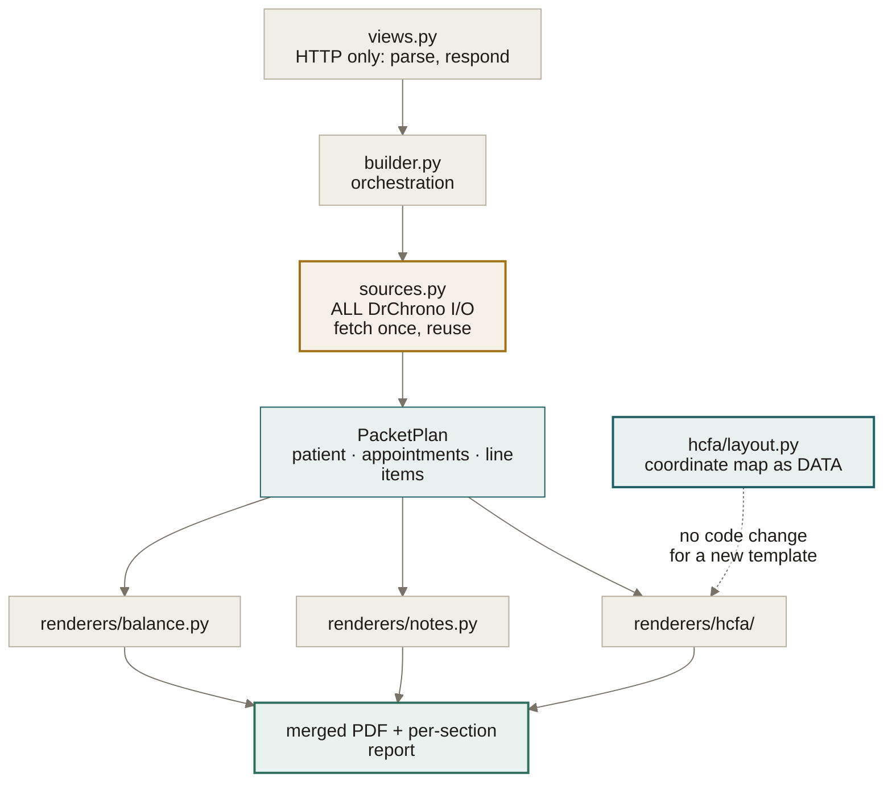

# v2 Redesign Plan

A phased plan for reworking `pdf/`, the data and request flow, authentication, and error handling — without throwing away the parts that work.

**Companion docs:** [`ARCHITECTURE.md`](ARCHITECTURE.md) describes the system as built. [`README.md`](README.md) is setup and orientation. This document is the forward plan; gap references ⚠ G*nn* map to the September 2026 code review.

---

## 0. What not to rewrite

The instinct behind this redesign is "it was my first project of this type, so it's badly designed." That isn't what the review found. The architecture scored well; the problems are **concentrated in three places and absent in two others**, which is a very different situation from a bad design.

| Verdict | What | Why |
|---|---|---|
| **Keep** | The five-app split (`verify` / `search` / `appts` / `pdf` / `core`) | Correct boundaries for this domain. A rewrite would land somewhere similar. |
| **Keep** | Read-through, no local patient mirror | Eliminates a whole class of breach. The single best decision in the codebase. |
| **Keep** | DrChrono as the sole identity provider | Right call. No password surface of your own. |
| **Keep** | The HCFA coordinate map | ~60 hand-derived positions. Hard-won, working, and expensive to re-derive. Move it, don't rewrite it. |
| **Keep** | Django + Postgres + Render + WhiteNoise | Nothing here is a constraint you're actually hitting. |
| **Rework** | `pdf/services.py` (522 lines, 0 tests) | Orchestration, I/O, and rendering in one module. This is the real target. |
| **Rework** | The appointment/line-item fetch path | Same data fetched up to three times → `3 + M + 3N` requests per PDF. |
| **Rework** | Identity edges in `verify/` | State validation, username collision, session termination. The flow is right; the edges aren't. |
| **Add** | Error taxonomy + logging + PHI scrubbing | Missing entirely. Build this **first** — everything else is guesswork without it. |

**The one-sentence version:** you're replacing organs, not the skeleton. Budget accordingly.

---

## 1. Four things the API docs change

I checked DrChrono's published API docs before designing the data flow. Three findings change the plan, and one is a one-line fix you can ship today.

**1.1 — `page_size: 50` is making truncation worse, not better.** DrChrono's page size **defaults to 250** and the `page_size` parameter can only *lower* it. `core/services.py:31` sets it to 50; `search/services.py:25` defaults to 50 and caps at 200. Both are actively reducing what you get back. Removing the parameter from the appointments call is a one-line change that immediately quintuples the window ⚠ G16.

**1.2 — `since` doesn't mean what the code assumes.** The docs define `since` as *"retrieves appointments updated after a given timestamp"* — last-modified, not appointment date. `get_valid_appointments` computes it from a 3-year lookback and treats it as a date filter. A five-year-old appointment edited last month appears; a three-year-old appointment never touched may not. For a date-bounded history query the correct parameter is `date_range`.

**1.3 — `date_range` is capped at 190 days unless flagged historical.** So a 3-year window needs either the historical flag or chunking into ~190-day segments. This is a real constraint on the pagination design in Phase 4 — verify the exact behaviour against your account before building.

**1.4 — Pagination is URL-cursor based** via `next` / `previous`, not page numbers. Follow `next` until exhausted.

**Open question worth ten minutes:** DrChrono documents *bulk endpoints* that I couldn't retrieve the specification for. If `line_items` accepts a multi-appointment filter, the `M` term in the cost model collapses to 1. Check this before building the per-appointment loop in Phase 3.

---

## 2. The cost model, before and after

`GenerateSelectedPDFView` currently issues **3 + M + 3N** sequential requests for *M* eligible and *N* selected appointments. The redundancy is threefold: `fetch_patient` runs twice, the appointment list is fetched by `appts` and again by `generate_balance_report`, and line items are fetched once for the balance report and again for the HCFA forms.

There is also a fourth redundancy the code doesn't need at all: the appointments **list** already requests `verbose=true`, and the eligibility filter already reads `clinical_note` out of it. `fetch_hcfa_data` needs only two fields from an appointment — `clinical_note.updated_at` and `icd10_codes`. If the verbose list carries both (verify this first), the *N* per-appointment detail calls disappear entirely.

| | Requests | At M=40, N=40 |
|---|---|---|
| Today | `3 + M + 3N` | **163** |
| After Phase 3 (fetch once, reuse) | `2 + M + N` | **82** |
| If the verbose list is sufficient | `2 + M + N` | 82, minus 40 detail calls already counted |
| If bulk line-items filtering exists | `2 + 1 + N` | **43** |

Of the remainder, *N* are clinical-note PDF downloads — actual payload, not overhead. That is the floor without caching.

---

## 3. Proposed structure for `pdf/`

The current module does orchestration, network I/O, data assembly, and canvas drawing in one file. The split below separates them so that each can be tested alone and a template change stops being a code change.

```
pdf/
  views.py              # HTTP only: parse the request, hand off, return the response
  builder.py            # orchestration: turn a PacketPlan into a merged document
  sources.py            # ALL DrChrono I/O for a packet — fetched once, reused
  plan.py               # PacketPlan: patient, appointments, line items, selection
  renderers/
    balance.py          # balance report
    notes.py            # clinical-note fetch + validation
    hcfa/
      layout.py         # the coordinate map, as data
      fields.py         # builds and validates the field dict
      render.py         # draws a validated field dict onto the canvas
```



**Three design changes carry most of the value:**

**3.1 — `PacketPlan`, built once.** One object holding the patient, the eligible appointments, and their line items, assembled by `sources.py` before any rendering starts. Every renderer reads from it; none of them fetch. This is what collapses the cost model, and it makes every renderer testable with a plain fixture instead of mocked HTTP.

**3.2 — Per-appointment failure isolation.** Today one bad phone number aborts the entire packet ⚠ G05. Instead, each appointment produces a `Section` that is either rendered pages or a recorded failure, and the builder assembles what succeeded. A patient with one malformed record yields a packet with 39 good claims and one clearly marked omission — not a "PDF generation failed" message and nothing to show for it.

This single change subsumes most of ⚠ G02–G08: those bugs stop being fatal even before you fix them individually.

**3.3 — The coordinate map becomes data.** `layout.py` holds `field_name -> (x, y)` rather than 200 sequential `drawString` calls. Three consequences: a revised HCFA template becomes a data edit; you can unit-test that every field sits inside the page box; and `render.py` shrinks to a loop. Keep the existing numbers verbatim — this is a move, not a re-derivation.

**Also fix while you're in here:** `blank_pdf = 'pdf/static/HCFA.pdf'` is CWD-relative ⚠ G21 — anchor it to `BASE_DIR` and move it out of `static/` so `collectstatic` stops publishing your blank claim form at a public URL.

---

## 4. Phasing


### Phase 0 — Make change safe

Non-negotiable and quick. You cannot safely redesign a system you can't diff or test.

- Add `.gitattributes`, normalize line endings in one dedicated commit ⚠ G26 — otherwise every change below lands inside a 582-line whitespace diff.
- Add `search/tests/__init__.py`, commit the directory, reconcile the two failures ⚠ G01 G19 G27.
- GitHub Actions running `manage.py test` and `check --deploy` on push ⚠ G30.
- Tag the current commit `v1-production`.
- Re-encode `requirements.txt` as UTF-8 ⚠ G28; drop the unused `uvicorn` ⚠ G29.

**Ships:** nothing user-visible. **Rollback:** not applicable.

### Phase 1 — Observability and error handling

Build this before touching anything else. Every later phase is unverifiable without it, and you currently have no idea how often the Phase 3 bugs actually fire in production.

**An exception taxonomy** in `core/errors.py`:

| Exception | Raised when | User sees |
|---|---|---|
| `DrChronoAuthError` | token invalid, refresh rejected | redirect to re-auth |
| `DrChronoUnavailable` | 5xx, timeout, connection error | "DrChrono isn't responding — try again shortly" |
| `DrChronoNotFound` | 404 on a known id | "That record no longer exists in DrChrono" |
| `IncompletePatientRecord` | HCFA validation fails; carries the field list | the specific missing fields, per appointment |

User-facing text derives from the exception **type**, never `str(e)` ⚠ G14.

**A logging config** with a console handler — Render captures stdout — plus:

- **A correlation id per request.** Middleware stamping a UUID onto every log record. Non-negotiable once one request fans out into 80+ API calls; without it the logs are unreadable.
- **A PHI scrubbing filter.** A `logging.Filter` that redacts names, DOBs, chart ids, and patient ids from records before emission. This is the piece that answers the question you parked in July: **once records are provably scrubbed at the boundary, a third-party error tracker becomes a safe option rather than a risk.** Build the filter now; decide on Sentry later, from a position where the decision is easy.

**Ships:** you can see production for the first time. **Rollback:** redeploy previous commit; purely additive.

### Phase 2 — Authentication

- **Validate OAuth state explicitly** before calling `fetch_token`; treat a missing `oauth_state` as a hard failure ⚠ G09. Do not rely on oauthlib — it silently skips the check when state is `None`.
- **Key identity on DrChrono's numeric user id**, not username ⚠ G10. Add a unique `drchrono_user_id` to the credential model and namespace the Django username so it can never collide with a local superuser. With a handful of staff accounts, a forced re-auth is simpler and safer than a data migration.
- **Encrypt the token columns** at rest ⚠ G15, or record an explicit decision not to.
- **Add session termination.** Per your point, DrChrono correctly gates *entry* — but exit doesn't propagate, so this is about ending the app's own 14-day session, not about authentication. Clear the session, delete the credential, POST to `DRCHRONO_REVOKE_URL` (already in settings, still unreferenced).
- **Shorten `SESSION_COOKIE_AGE`.** 14 days is long for PHI on a shared machine; a clinic shift is 8–12 hours.

**Ships:** one forced re-auth for staff. **Rollback:** redeploy previous commit; the schema change is additive, so the old code tolerates the new column.

### Phase 3 — Restructure `pdf/`

As designed in §3. Do this **after** Phase 0, never before — 522 lines with zero coverage is not something to refactor blind. Write characterization tests against a real packet first: capture one known-good PDF, then assert the restructured code produces the same page count and field values.

**Ships:** identical output, roughly half the API calls, and failures that no longer discard the packet. **Rollback:** redeploy previous commit.

### Phase 4 — Data and request flow

- A `paginate(url, params)` generator in `core` that follows `next` ⚠ G16; drop the `page_size` override (§1.1); switch to `date_range` with chunking (§1.2–1.3).
- **Session stores appointment and patient ids only**, never records ⚠ G13. The results page re-fetches. Add `clearsessions` to the deploy.
- **Patient name out of the URL** ⚠ G12 — route becomes `patient/<int:patient_id>/historical/`, name resolved server-side. Fix the broken redirect target ⚠ G02 in the same change; it lives in the same four call sites.

**Ships:** complete packets for high-volume patients. **Rollback:** redeploy previous commit.

### Phase 5 — Decide about background jobs

Deliberately last, and deliberately a decision rather than a task.

| Option | Cost | When it's right |
|---|---|---|
| **Bounded synchronous** (recommended first) | Free | If Phase 3+4 bring the worst real case comfortably under Render's timeout. Cap *N*, show an estimate. |
| **Queue** (Render worker + Redis + RQ) | A second service, ongoing spend, more ops surface | Only if Phase 1 telemetry shows real requests still approaching the limit. |

Halving the call count may remove the problem outright. **Decide from the Phase 1 numbers, not from the fear of a timeout.** Adding a queue you don't need is the most expensive way to fix a problem you no longer have.

---

## 5. Keeping v1 as a fallback

You asked how to hold onto the working version. My honest advice is that **the phasing above is the backup strategy**, and it's a better one than a parallel deployment.

A parallel deployment is the right tool for a big-bang cutover: build v2 entirely, run both, switch. It's also how you end up debugging four subsystems at once with no idea which one broke, while a second DrChrono redirect URI and a second Render service quietly cost you money and drift out of sync.

Because every phase above ships independently and is individually revertible, you get the same safety with far less machinery:

1. **Tag `v1-production` now.** Rollback is `git revert` or redeploying that tag — under a minute, and the clinic never sees a broken state for longer than a deploy.
2. **Work on a branch, merge per phase.** Each merge is small enough to reason about.
3. **Let each phase sit in production for a few days** before starting the next. Phase 1 exists specifically so that "did that break anything?" has an answer.
4. **Don't run two services.** The only scenario that justifies it is a change you can't roll back — and there isn't one here. The Phase 2 schema change is additive, so even that reverts cleanly.

The one thing worth preserving separately: **a known-good output PDF**, generated today, committed as a test fixture. That's your real regression baseline — far more useful than a copy of the old code, because it tells you whether v2 still produces the right document.

---

## 6. What success looks like

Measurable, so you can tell whether the redesign worked rather than whether it felt productive.

| Target | Today | After |
|---|---|---|
| Requests per PDF (M=N=40) | 163 | ≤ 85 |
| A malformed record costs you | the entire packet | one section, clearly marked |
| Tests collected by `manage.py test` | 0 | all of them, green in CI |
| Coverage of `pdf/` | 0% | the field/layout logic under test |
| Appointment history completeness | truncated at 50, silently | complete, or explicitly reported |
| Time to diagnose a production failure | a staff member tells you | a correlation id in the logs |
| PHI in URLs and session rows | present | ids only |

---

*Plan written 2026-09-02 against the codebase as of that date. API behaviour in §1 is from DrChrono's published documentation — verify §1.3 and the bulk-endpoint question against your own account before building on them.*
