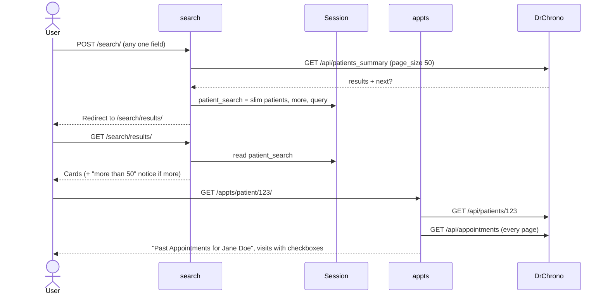
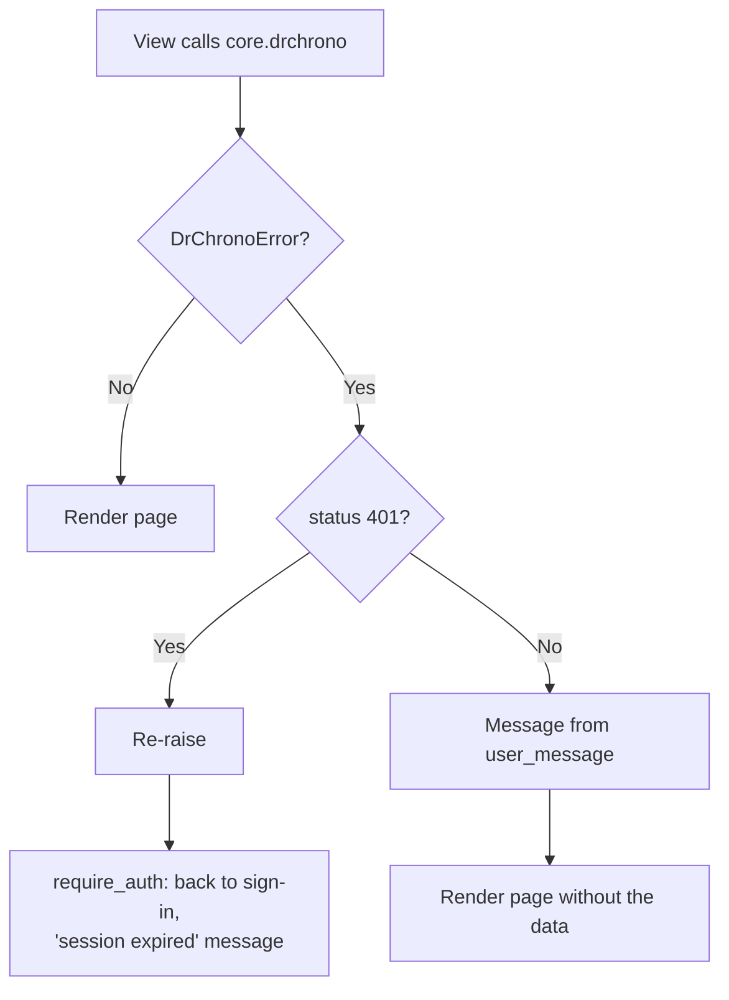

# Search & Appointments Overhaul Plan

Rewrite of `search` (find a patient) and `appts` (pick visits) as plain function views. The work also covers one shared change: friendly DrChrono error messages, with a rejected token sending the user to sign in. Scope is `search` and `appts`, plus small, named changes in `core`, `verify` and `pdf` that these require.

## Decision

**Direction A: keep the session, slimmed down.** The flow stays the same: submit the search, get redirected, see the results page. The session stores only what the results page shows.

- "Back to results" from the appointment list keeps working.
- No patient names or dates of birth go into URLs.
- The patient's name leaves the appointment-list URL.

Rejected: a GET search form (B: puts names and dates of birth in URLs, logs and browser history), and rendering results straight from the form submission (C: going back means resubmitting the form).

## DrChrono facts this relies on

From the [API docs](https://drkurokawa.drchrono.com/api-docs/):

- `GET /api/patients_summary` filters by `first_name`, `last_name`, `date_of_birth` (`YYYY-MM-DD`); `page_size` lowers the page size (default 250); `next` is set when there are more matches.
- The spec lists the reply as `{"previous", "data", "next"}`, but production reads `results` and works, so `results` stays. The manual check (step 5) confirms it.
- `GET /api/patients/{id}` returns `first_name`, `last_name`, `date_of_birth` (used for the list's heading).
- Status codes we act on: `401` (token rejected), `403` (no permission), `404` (not found), `429` (hourly limit of 500 calls), `5xx`; no status means DrChrono never answered.

## Problems being fixed

| Problem | Where |
|---|---|
| `search_patients` is a helper decorated like a view (`login_required` with a wrong name, plus `require_auth`), so credentials are looked up twice and a failure can return a page instead of results | `search/services.py` |
| Dead date-of-birth conversion inside a bare `except: pass` (the form already parses both formats) | `search/services.py` |
| Error messages like "A client error occurred while searching patients.", a "Unsufficent" typo, and a 401 shows "Please try again" instead of going to sign-in | `search/services.py`, `search/views.py` |
| Results capped at 50 with no notice when DrChrono has more; the `next` cursor is stored but never used | `search` |
| The session stores DrChrono's full patient records | `search/views.py` |
| Page and docstring say last name is required (any one field works) | `search.html`, `forms.py` |
| `LoginRequiredMixin` on top of `require_auth`, empty `dispatch` overrides, unused `login_url`s, mid-file imports, unused imports | `search/views.py`, `appts/views.py`, `search/urls.py` |
| Patient name in the URL (`/appts/patient/123_Jane Doe/historical/`): names in request logs and browser history; also passed to `pdf` as a hidden field and query parameter | `appts/urls.py`, template, `pdf/views.py` |
| Raw error text shown to users ("Failed to load appointments: DrChrono request failed: 401 …"); a 401 doesn't go to sign-in | `appts/views.py` |
| A `ListView` for something that isn't a database list | `appts/views.py` |
| Known bug: "no visits selected" redirects to `appts:historical_list` (wrong namespace, missing name), which gives a 500 | `pdf/views.py` (fixed by the URL change) |

## Target design

### Shared: DrChrono errors

- **`core.drchrono.user_message(error)`** — maps `DrChronoError.status` to plain text:

  | Status | Message |
  |---|---|
  | none | "DrChrono isn't responding. Try again in a moment." |
  | 403 | "Your DrChrono account doesn't have permission to see this." |
  | 404 | "DrChrono couldn't find that record." |
  | 429 | "DrChrono's hourly request limit was reached. Try again after the top of the hour." |
  | anything else | "DrChrono returned an error. Try again in a moment." |

- **401 is handled once**, in `verify.services.require_auth`. If the view raises `DrChronoError` with status 401, it returns `back_to_sign_in(request, 'Your DrChrono session expired, please sign in again.')`. Views catch `DrChronoError` and re-raise a 401 (`if e.status == 401: raise`); any other status becomes `user_message(e)`.

### `search`

| File | Contents |
|---|---|
| `services.py` | `search_patients(token, first_name='', last_name='', date_of_birth=None) -> (patients, more)`. One `drchrono.get` with `page_size=50` and only the filled-in fields. Each patient is slimmed to `id`, `first_name`, `last_name`, `date_of_birth`, `chart_id`. `more` is `True` when DrChrono returned `next`. No decorators, no error mapping. |
| `views.py` | `search(request)`: GET shows the form; a valid POST searches, stores `{'patients', 'more', 'query'}` under one session key `patient_search`, and redirects to results. No matches: re-shows the form with "No patients found matching your criteria." `results(request)`: renders that session entry. Both use `@require_auth`. |
| `forms.py` | Same fields and rule (any one field); accurate one-line docstring. |
| `urls.py` | Same two routes and names (`search`, `results`). |
| templates | `search.html`: "Enter a first name, last name or date of birth." `results.html`: links to `/appts/patient/<id>/`; when `more`, shows "DrChrono found more than 50 matches. Add details to narrow the search." (replaces the "more than 30" hint). |

### `appts`

| File | Contents |
|---|---|
| `views.py` | `appointment_list(request, patient_id)` with `@require_auth`: fetches `drchrono.patient` (for the heading) and `eligible_appointments`. On `DrChronoError` (not 401): shows `user_message`, empty list. |
| `urls.py` | `patient/<int:patient_id>/` → `historical_list` (name kept). Old name-in-URL links stop working. |
| template | Heading from the fetched patient ("Past Appointments for Jane Doe"). The form posts to `pdf_app:generate_selected` with no `patient_name` field or query parameter. |

### `pdf` (call sites only)

- Both redirects back to the list become `redirect('appts_app:historical_list', patient_id=patient_id)`. Drops reading `patient_name` from the POST.
- This fixes the "no visits selected" known bug. Its test changes only to the new URL.

API calls: opening an appointment list costs 1 more call (the patient), so 1 + one per 25 visits.

### Diagrams

Search to appointment list (session holds the slim results):

DrChrono errors on a page:

## Implementation steps

Each step ends with `pytest` passing for what it touches, then its **simplicity check**. If a check fails, simplify before moving on.

Applies to every step:
- Plain function views; no class-based views or mixins.
- No wrapper that only renames another function.
- No settings, constants or parameters for values that never change or are used once.
- No `try`/`except` broader than `DrChronoError`; no bare `except`.
- No dead code, commented-out code, `print` debugging, mid-file imports or unused imports.
- Comments explain *why*; docstrings are one line.

1. **Shared errors**: add `user_message` to `core/drchrono.py`; `require_auth` turns a 401 raised by the view into the sign-in redirect. Tests: each status's message; a view raising 401 redirects to `/` with the message; other statuses propagate.

   *Simplicity check:*
   - `user_message` is one lookup with a default (no if/elif ladder).
   - `require_auth` gains one `except` clause, no more than 4 lines.

2. **`search`**: rewrite `services.py`, `views.py`, `forms.py` docstring, templates; rewrite `search/tests.py`. Tests: params sent (only filled fields, `page_size` 50, ISO date), slimming, `more` flag, session contents, no-matches message, each error path (401 → sign-in, others → `user_message`), "more than 50" notice, results link uses the ID only.

   *Simplicity check:*
   - `services.py` ≤ 25 lines; `views.py` ≤ 45 lines.
   - One session key (`patient_search`).
   - No status-code branching in `search`.

3. **`appts` + `pdf` call sites**: rewrite `appts/views.py`, `urls.py`, template; update `pdf/views.py` redirects; rewrite `appts/tests.py`, update `pdf` tests to the new URL. The "no visits selected" known-bug test must pass.

   *Simplicity check:*
   - `appts/views.py` ≤ 25 lines.
   - `grep -rn "patient_name" --include=*.py --include=*.html` in app code returns nothing.
   - The `pdf/views.py` diff touches only the redirects and the removed `patient_name` read.

4. **Docs**: `search/DOC.md`, `appts/DOC.md` (detail matching the code), `core/DOC.md` (`user_message`), `verify/DOC.md` (401 handling), `SYSTEM_MAP.md` (journey steps 3–5, error table, URL), `CLAUDE.md` (flow section, known bugs now 2), README if routes are listed.

   *Simplicity check:*
   - No doc mentions the name-in-URL route, `ListView`, `LoginRequiredMixin`, "client error", or "Enter at least the last name".

5. **Manual check (local)**:
   - search by last name, by date of birth only, and something with no matches
   - a broad search that hits "more than 50" (if your data allows)
   - open a patient: heading shows the name, URL shows only the ID
   - "Back to Patient Search" returns to the same results
   - generate a PDF, then submit with no visits ticked (back to the list with a warning, no error page)
   - log out and confirm the results page is empty

   *Simplicity check:*
   - Read `search/views.py`, `search/services.py` and `appts/views.py` top to bottom once more; anything that needs a second read gets simplified.

6. **Shorter sessions** (was optional extra 1): `SESSION_COOKIE_AGE = 12 * 60 * 60` in `settings.py`, so a forgotten sign-in, and the slim search results with it, expire within a clinic day instead of 2 weeks. Test: the setting, and that the session cookie's max-age matches.

   *Simplicity check:*
   - One setting line with a one-line *why* comment; no middleware or custom expiry code.

7. **Merge**: `/simplify` on the full diff, apply what it finds, PR to `main`. No Render changes (staff sign in once a day).

## Done when

- The "no visits selected" known-bug test passes; the other 2 known bugs (`pdf`) unchanged.
- All other tests pass; every step's simplicity check holds.
- No patient name in any URL, hidden field or query string.
- Sessions expire after 12 hours.
- Local manual check passes.

## Optional extras (not in scope until chosen)

1. ~~Shorter sessions~~ (now step 6).
2. **"Show more" button**: follow `next` to load the next 50 matches instead of only the notice.
3. **Search by chart ID**: add a chart ID field (DrChrono supports `chart_id`; the form doesn't offer it today).
