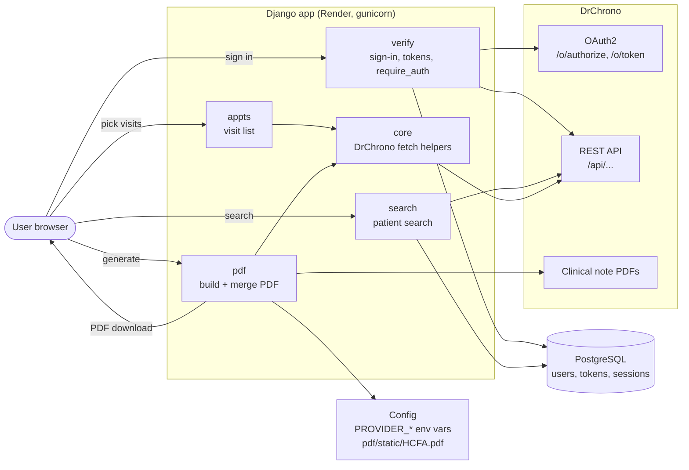
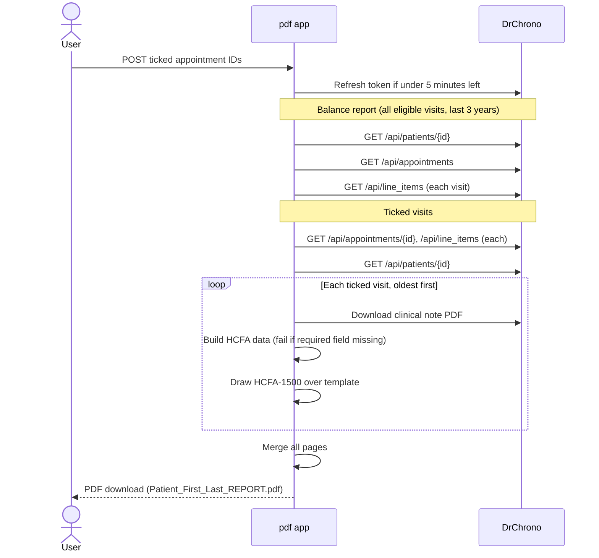

# System Map

How the [DrChrono PDF Compiler](README.md) fits together: what the user does, which parts run, and what comes out. Per-app details are in each folder's `DOC.md`.

## User journey

| # | Page | User does | App does | User sees |
|---|---|---|---|---|
| 1 | `/`, `/authorize/` (`verify`) | Opens the site, clicks **Sign in with DrChrono** | Shows the sign-in page (or goes to search if already signed in); saves a random `state` and redirects | DrChrono sign-in |
| 2 | `/oauth/callback` (`verify`) | Signs in to DrChrono, allows access | Checks `state`, exchanges code for tokens, saves them to a passwordless local user | "Successfully connected as …", search page |
| 3 | `/search/` (`search`) | Enters first name, last name and/or DOB, clicks **Search Patients** | Calls `/api/patients_summary`, stores results in session | "Found N matching patient(s)." |
| 4 | `/search/results/` (`search`) | Clicks **Select & View Appointments** | Loads last 3 years of past, attended visits with a clinical note PDF | Patient cards (name, DOB, chart ID) |
| 5 | `/appts/patient/<id>_<name>/historical/` (`appts`) | Unticks unwanted visits, clicks **Generate PDF Report for Selected** | — | Visits newest first, all ticked |
| 6 | `POST /pdf/patient/<id>/generate-selected/` (`pdf`) | Waits | Fetches data, draws forms, merges | Download `Patient_<First>_<Last>_REPORT.pdf`, or back to step 5 with errors |

## Components



Every page after sign-in passes through `verify.require_auth`: it refreshes the token when less than 5 minutes are left, or sends the user back to the sign-in page.

## PDF generation (step 6)



## Output

```
Patient_<First>_<Last>_REPORT.pdf
├── Balance report        provider, patient, total balance, unpaid line items
├── Visit A
│   ├── Clinical note     DrChrono's PDF, as is
│   └── HCFA-1500         one page
├── Visit B
│   ├── Clinical note
│   └── HCFA-1500
└── … one pair per ticked visit
```

HCFA-1500 box sources:

| Boxes | Source |
|---|---|
| 2, 3, 4, 5, 7, 11 | DrChrono patient: name, DOB, sex, address, cell phone |
| 21 | DrChrono appointment: ICD-10 codes |
| 12, 31 dates | Clinical note's `updated_at` |
| 24A, 24D, 24F, 28 | DrChrono line items: dates, CPT codes, charges, total |
| 24J, 25, 26, 31, 32, 33 | Env vars (see [README](README.md#environment-variables)) |
| 1, 6, 10, 11d, 12, 13, 24B, 24E, 24G, 27 | Hardcoded (see [`pdf/DOC.md`](drchrono_compiler/pdf/DOC.md#hardcoded-hcfa-values)) |

## Data kept

| Where | What |
|---|---|
| Database | Django user (no password), DrChrono access/refresh tokens |
| Session | OAuth state, last search results and filters |
| Env vars | DrChrono app credentials, practice details |
| Not stored | Appointments, line items, generated PDFs |

## Errors the user sees

| Situation | Message / result |
|---|---|
| Token expiring | Refreshed silently |
| Not signed in | Sign-in page |
| Token can't be refreshed | Sign-in page: "Your DrChrono session expired, please sign in again." |
| Cancel on DrChrono's screen | Sign-in page: "Sign-in was cancelled." |
| Stale or forged sign-in return | Sign-in page: "Sign-in expired, please try again." |
| DrChrono error during sign-in | Sign-in page: "Couldn't sign in to DrChrono, please try again." |
| CSRF failure (stale session) | Sign-in page: "Your session has expired, please sign in again." |
| Empty search form | "Please provide at least one of: First Name, Last Name, or Date Of Birth" |
| No matches | "No patients found matching your criteria." |
| DrChrono search error | "A client error / server error occurred while searching patients." |
| Visits can't load | "Failed to load appointments: …", empty list |
| Patient data missing for HCFA | "PDF generation failed." plus missing fields, back on visit list |
