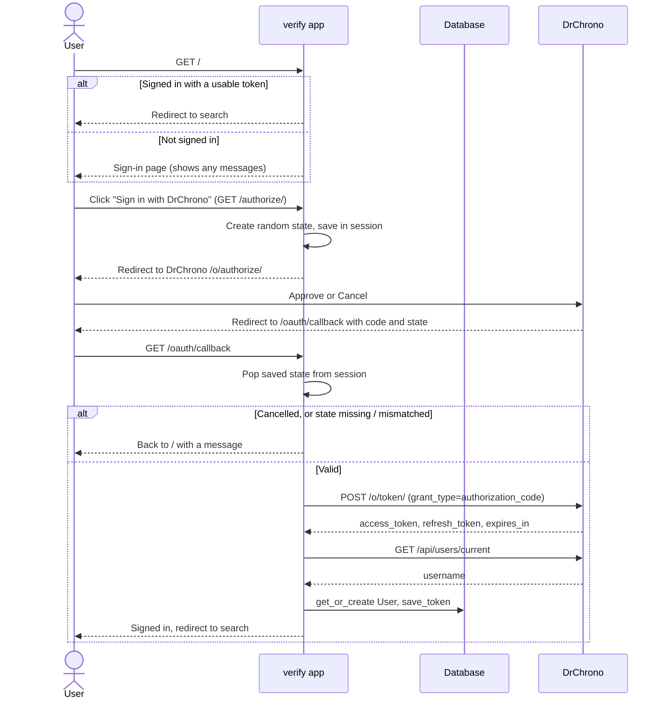
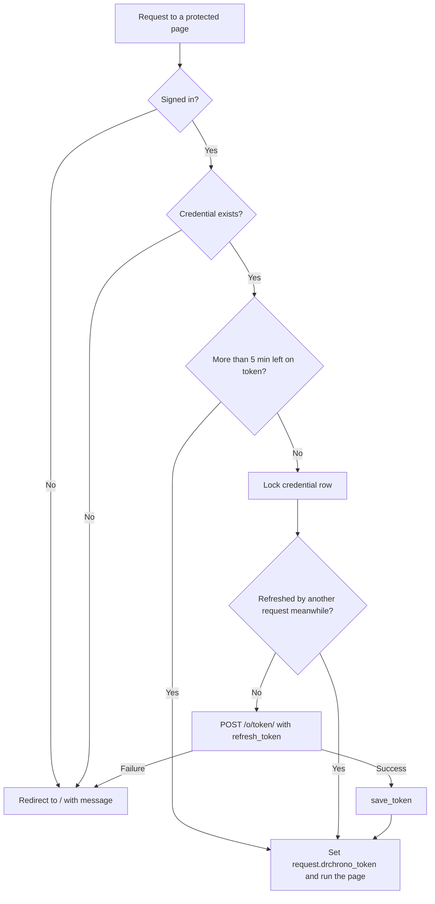

# Verify Overhaul Plan

Rewrite of the `verify` app (DrChrono sign-in and tokens) as a lean, hand-written OAuth2 flow. Scope is `verify` only; other apps keep working unchanged.

## Decision

**Direction A: lean, hand-written flow.** One Django `User` + `DrChronoCredential` per staff member. Sign-in stays DrChrono's OAuth2 authorization-code flow; only the helper library goes. Each OAuth2 step is a plain `requests` call, as in DrChrono's own documented example.

- Every staff member signs in as themselves, so DrChrono's audit trail shows who accessed which patient (required for PHI).
- Drops the `requests-oauthlib` and `oauthlib` helper libraries (OAuth2 itself stays); no new dependencies.
- No database migration; no changes to `search`, `appts` or `pdf`.

Rejected: Authlib (B, swaps one dependency for another, saves ~30 lines), shared practice connection (C, loses per-person audit trail), session-only (D, needs a migration and edits outside `verify`).

## DrChrono facts this relies on

From the [API docs](https://drkurokawa.drchrono.com/api-docs/):

- Authorize: `GET https://app.drchrono.com/o/authorize/?redirect_uri=…&response_type=code&client_id=…&scope=…`
- Cancel on DrChrono's screen returns to the redirect URI with `error=access_denied`.
- The authorization code is single-use and expires within seconds; exchange it immediately.
- Token exchange and refresh: `POST https://app.drchrono.com/o/token/` with `grant_type` `authorization_code` (plus `code`, `redirect_uri`) or `refresh_token` (plus `refresh_token`), and `client_id`, `client_secret`.
- Access tokens last 48 hours (`expires_in`). The docs don't say whether refresh issues a new refresh token, so save one if returned, else keep the old one.
- `GET /api/users/current` redirects to `/api/users/{id}` and returns `id`, `username`, `doctor`, `practice_group`, `is_doctor`, `is_staff`.
- Rate limit: 500 calls/hour per app. Sign-in costs 2 calls, a refresh 1.

## Problems being fixed

| Problem | Where |
|---|---|
| Login loop: callback returns early for a signed-in user and drops the new tokens | `views.oauth_callback` |
| `set_unusable_password()` never saved, so new users get a blank password | `views.oauth_callback` |
| `/` jumps straight to DrChrono, so error and "session expired" messages are never seen; cancelling bounces back to DrChrono | `views.connect_drchrono` |
| `error=access_denied` and network errors during user lookup aren't handled (generic message or 500) | `views.oauth_callback` |
| Token saving duplicated between callback and refresh | `views.py`, `services.py` |
| Refresh only after expiry, so a token can expire mid-PDF; two tabs refreshing at once can invalidate each other | `services.get_valid_access_token` |
| `DrChronoAuthError('scope', cred.scope)` passes arguments in the wrong order | `services.refresh_token` |
| Tokens shown in plain text on the admin edit form | `admin.py` |
| Unused revoke URL; DrChrono URL constants in project settings | `settings.py` |

## Target design

### Files

| File | Contents |
|---|---|
| `services.py` | DrChrono URL constants, `authorize_url`, `request_token`, `fetch_current_user`, `save_token`, `get_access_token`, `require_auth`, `get_valid_access_token` (compatibility wrapper) |
| `views.py` | `connect_drchrono`, `authorize`, `oauth_callback`, `csrf_failure` |
| `templates/verify/connect.html` | New sign-in page: messages + "Sign in with DrChrono" button |
| `urls.py` | `/` → `connect_drchrono`, `/authorize/` → `authorize`, `/oauth/callback` → `oauth_callback` (path unchanged; it's registered with DrChrono) |
| `models.py` | Same fields (no migration); `is_expired` kept for the admin list |
| `exceptions.py` | `DrChronoAuthError` only, with a `.message` property (`search` uses it) |
| `admin.py` | Same list columns; token fields excluded from the edit form |

### `services.py`

```python
AUTHORIZE_URL = 'https://app.drchrono.com/o/authorize/'
TOKEN_URL = 'https://app.drchrono.com/o/token/'
CURRENT_USER_URL = 'https://app.drchrono.com/api/users/current'
REFRESH_MARGIN = timedelta(minutes=5)

def authorize_url(state: str) -> str
def request_token(**data) -> dict                 # POST /o/token/ + client credentials; any failure -> DrChronoAuthError
def fetch_current_user(access_token: str) -> dict  # GET /api/users/current; any failure -> DrChronoAuthError
def save_token(user, token: dict) -> DrChronoCredential   # only place tokens are written; keeps old refresh token if none returned
def get_access_token(user) -> str                 # see below
def require_auth(view)                            # unchanged name/behaviour: sets request.drchrono_token or redirects to '/'
def get_valid_access_token(request) -> str        # kept so search/appts/pdf work unchanged
```

`get_access_token(user)`:
1. Read the credential. No credential → `DrChronoAuthError`.
2. More than `REFRESH_MARGIN` left → return the token (no lock, one query).
3. Otherwise, inside `transaction.atomic()`: re-read with `select_for_update()`, re-check (another request may have refreshed), then `request_token(grant_type='refresh_token', …)` and `save_token`.

### Sign-in flow

1. **`/` (`connect_drchrono`)**: signed in with a usable token → redirect to search. Otherwise render the sign-in page (shows any messages).
2. **`/authorize/` (`authorize`)**: `state = secrets.token_urlsafe(32)`, store in session, redirect to `authorize_url(state)`.
3. **`/oauth/callback` (`oauth_callback`)**, in order:
   1. Pop `oauth_state` from the session.
   2. `error` in query → "Sign-in was cancelled." → `/`.
   3. Missing or mismatched `state` (`secrets.compare_digest`) → "Sign-in expired, please try again." → `/`.
   4. `request_token(grant_type='authorization_code', code=…, redirect_uri=…)`, then `fetch_current_user`. Any `DrChronoAuthError` → "Couldn't sign in to DrChrono, please try again." → `/`.
   5. `get_or_create` user by username; on create, `set_unusable_password()` and save.
   6. `save_token(user, token)` (always, fixing the login loop).
   7. `login()`, success message, redirect to search.
4. **`require_auth`** failure → "Your DrChrono session expired, please sign in again." → `/`.

### Diagrams

Sign-in (OAuth2 authorization-code flow):



Every protected page (`require_auth` → `get_access_token`):



### User-visible changes

- `/` is a sign-in page with one button instead of an instant redirect (one extra click).
- Cancel, expired sign-in and DrChrono errors now show a readable message.
- Signed-in users visiting `/` go straight to search.
- Re-authorizing after a failed refresh works (no more login loop).

### Removed

- `requests-oauthlib` and `oauthlib` from `requirements.txt` (helper libraries only; the OAuth2 flow is implemented directly in `services.py`).
- `OAUTHLIB_INSECURE_TRANSPORT` (no longer needed locally).
- `DRCHRONO_AUTH_URL`, `DRCHRONO_TOKEN_URL`, `DRCHRONO_REVOKE_URL` from `settings.py` (moved into `services.py` or unused). `DRCHRONO_CLIENT_ID`, `DRCHRONO_CLIENT_SECRET`, `DRCHRONO_REDIRECT_URI`, `DRCHRONO_SCOPES` stay as env vars.

## Implementation steps

Each step ends with `pytest` passing for what it touches, then its **simplicity check**. A step isn't done until every check holds; if one fails, simplify before moving on rather than noting it for later.

Applies to every step:
- No class where a function will do; no base classes, mixins, managers or registries for one use.
- No wrapper that only renames or passes through to another function (the `get_valid_access_token` compatibility wrapper is the one allowed exception, and it is one line).
- No settings, constants or parameters for values that never change or are used once.
- No `try`/`except` that catches broader than needed, re-raises unchanged, or exists only to log.
- No dead code, commented-out code, `print` debugging or `PRINT_ERRORS` flags.
- Comments explain *why*, never restate the code; docstrings are one line.

1. **Services**: rewrite `services.py` and slim `exceptions.py`. Update `verify/tests.py` service tests: refresh margin, lock re-check, refresh keeps old refresh token, failures raise `DrChronoAuthError`, compatibility wrapper.

   *Simplicity check:*
   - `services.py` ≤ 90 lines including blank lines (raised from 80 after step 1: what remained was all real logic); `exceptions.py` ≤ 6 lines.
   - One HTTP call site for `/o/token/` (`request_token`) and one place tokens are written (`save_token`); `grep -n "access_token =" verify/` shows only `save_token`.
   - `get_access_token` reads top to bottom with at most two levels of nesting; the lock only exists on the refresh path.
   - Client credentials added in exactly one place (`request_token`), not by each caller.
   - Error handling: each function catches `requests.RequestException` (or the specific `KeyError` on a bad response) once and raises `DrChronoAuthError`; no status-code branching unless behaviour differs.

2. **Views, template, URLs**: new `connect_drchrono` page, `authorize`, rewritten `oauth_callback`, `connect.html`, `/authorize/` route. Update callback tests to patch `verify.services.requests` instead of `OAuth2Session`; add tests for cancel, state mismatch, network error, signed-in user at `/`. The two known-bug tests (login loop, unusable password) must pass.

   *Simplicity check:*
   - `views.py` ≤ 60 lines; plain function views, no class-based views or forms.
   - `oauth_callback` has one failure path: every failure sets a message and returns `redirect('verify_app:connect_drchrono')`; no duplicated redirect/message code per branch (use early returns or one shared helper at most).
   - Views contain no HTTP or token logic; they only call `services`.
   - `connect.html` ≤ 20 lines, extends `layout.html`, inline styles match the existing pages, no new CSS file or JavaScript.
   - `urls.py` is three `path()` lines.

3. **Admin**: exclude token fields; test the edit form doesn't contain them.

   *Simplicity check:*
   - `admin.py` ≤ 10 lines: `list_display`, `readonly_fields`, `exclude`. No custom forms, actions or methods.

4. **Cleanup**: remove the two packages from `requirements.txt` (preserve UTF-16 LE + CRLF), remove the URL settings. Full suite: only the 4 non-`verify` known-bug tests may fail.

   *Simplicity check:*
   - `grep -rn "oauthlib\|OAuth2Session\|DRCHRONO_AUTH_URL\|DRCHRONO_TOKEN_URL\|DRCHRONO_REVOKE_URL" .` returns nothing.
   - No leftover imports or unused functions in `verify/` (check each `import` is used; every function in `services.py` has a caller).
   - `verify/` app code (excluding tests and migrations) is smaller than before (205 lines today), even with the new template.

5. **Docs**: `verify/DOC.md`, `README.md` (local setup without `OAUTHLIB_INSECURE_TRANSPORT`), `SYSTEM_MAP.md` (journey steps 1–2, diagram labels), `CLAUDE.md` (auth section, local env).

   *Simplicity check:*
   - `verify/DOC.md` length matches the app's complexity (no line limit): explains behaviour and the reasons behind it, without restating the code line by line.
   - No doc describes behaviour that the code doesn't have (search each doc for `OAuth2Session`, `oauth_state` handling, "redirects to DrChrono" at `/`).

6. **Manual check (local)**: sign in; cancel on DrChrono; visit `/` while signed in; set `expires_at` in the past via admin or shell and load a page (refresh happens silently); delete the credential and load a page (back to sign-in with a message).

   *Simplicity check:*
   - Read `services.py` and `views.py` top to bottom once more. Anything that needs a second read to understand gets simplified or a one-line *why* comment.

7. **Merge**: PR to `main`. No Render env changes needed; `DRCHRONO_REDIRECT_URI` stays the same.

   *Simplicity check:*
   - Review the full PR diff with `/simplify` (reuse, simplification, efficiency) and apply anything it finds before merging.

## Done when

- All `verify` tests pass, including the two known-bug tests; other apps' tests unchanged.
- No `requests_oauthlib` / `oauthlib` imports remain.
- Every step's simplicity check holds; `verify/` app code is under 205 lines.
- Local manual check (step 6) passes.

## Optional extras (not in scope until chosen)

1. **Log out**: POST `/logout/` revokes the token at `/o/revoke_token`, deletes the credential, signs out. Needs a button in `templates/layout.html`.
2. **Restrict to the practice**: only allow DrChrono users whose `practice_group` matches a `DRCHRONO_PRACTICE_GROUP` env var. Today any DrChrono account can sign in (seeing only its own practice's data).
3. **Return to original page** after re-sign-in instead of always going to search.
4. **Match users by DrChrono user ID** instead of username (needs a migration).
5. **Encrypt stored tokens** (adds a dependency).
